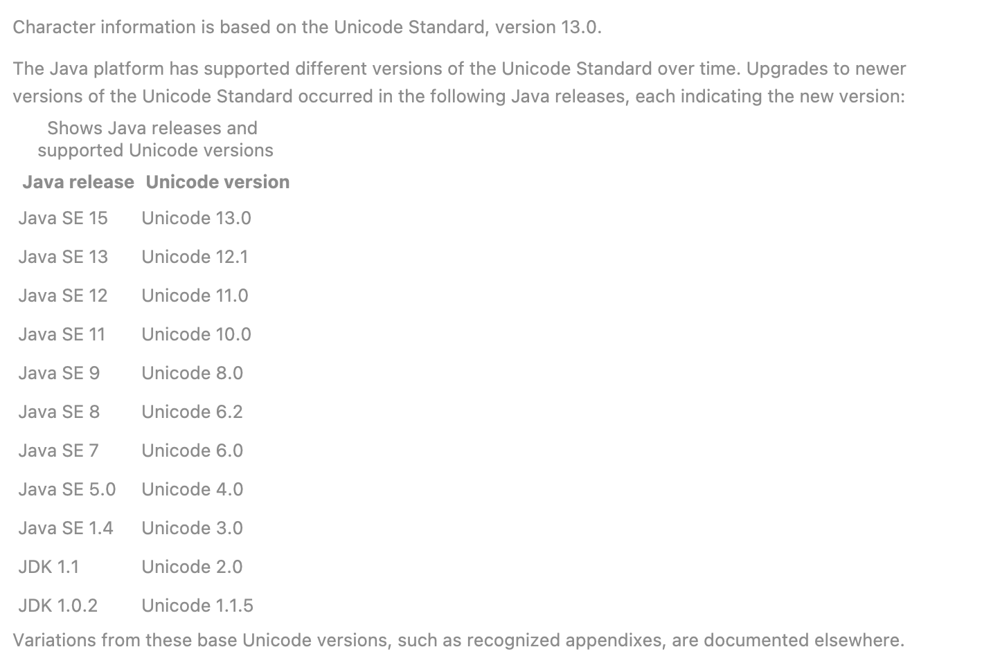
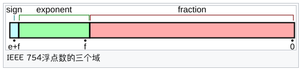

# Java语言规范

## 引言

### 类型（types）、值（values）、变量（variables）

类型：

1. 基本类型：primitive types，其值不共享状态。
   1. 各种二进制补码整型（byte, short, int, long）
   2. IEEE754标准单精度、双精度浮点数（float, double）
   3. 布尔类型（bool）
   4. unicode字符类型（char），实际使用UTF-16编码，占用2个字节
2. 引用类型：reference types，值是动态创建的对象，是类或者数组的实例，都是继承自Object的：
   1. 类类型（class types）
   2. 接口类型（interface types）
   3. 数组类型（array types）

变量是类型化的存储位置:

1. 基本类型的变量保存该确切基本类型的值
2. 引用类型的变量保存空引用或者该类型及其子类型的对象的引用

### 异常

1. 受检异常（checked exceptions）
2. 运行时异常（run-time exceptions）
3. 错误（errors）:不推荐捕获或处理 Error，除非你在编写底层框架或 JVM 插件等特殊场景。

### main方法参数

java语言中args[0]就是命令行传入的第一个参数了，这有别于c/c++，python中args[0]是脚本名。当然在java中你可以通过反射或堆栈拿到类和方法名

### Notation符号表示法

The type system of the Java programming language occasionally relies on the
notion of a substitution. The notation $[F_1:=T_1,...,F_n:=T_n]$ denotes substitution
of $F_i$ by $T_i$ for $1 ≤ i ≤ n$.

## 语法

### 上下文无关文法

上下文无关文法由一堆产生式组成。每个产生式的左边都是一个抽象的符号（非终态），右边是一个或多个符号（有终态、也有非终态的）组成的序列。终结符（终态的符号）取自某个特定的字母表。
从一个由单个可区分的非终结符组成的句子（目标符号）开始，给定的上下文无关文法指定了一种语言（即可能的终结符号序列的集合，该序列可以通过用产生式的右侧符号重复替换序列中的任何非终结符而产生- 非终结符在产生式的左侧）。

### 词法

词法的终结符是由来自Unicode字符集的字符组成的。它定义了一系列的产生式，这些产生式开始于全局的Input符号，描述了如何将Unicode字符序列转换为输入元素序列。

这些输入元素，丢弃了空白符和注释，形成了Java语言的语法终结符，成为tokens。
tokens：Java语言中的identifiers（标识，如变量名）、keywords（关键字，如while）、literals（字面量，如`5`）、separators（分隔符，如`;`）、operators（操作符，如`+`）

### 语法

语法由词法定义的token作为其终结符。它定义了一系列产生式，这些产生式由CompilationUnit符号开始，描述了一系列的token如何组成一个语法正确的程序。

### 语法符号

- 非终结符使用斜体：
  _IfThenStatement_: 
      if ( _Expression_ ) _Statement_

- {x}表示x出现0到多次：
  _ArgumentList_: 
      _Argument_ {, _Argument_}

- [x]表示x可选：
  _BreakStatement_: 
      break [_Identifier_];

- 很长的产生式右边可以通过明显缩进在第二行继续。
  _NormalClassDeclaration_:
      [_ClassModifier_] class _Identifier_ [_TypeParameters_]
          [[_Superclass_] [_Superinterfaces_] _ClassBody_

- 产生式右边的短语 (one of) 表示每个以下一行或多行的终端符号是另一种定义：
  _ZeroToThree_:
      _(one of)_
      0 1 2 3

- 当产生式中的替代项似乎是一个记号时，它代表序列组成这样一个标记的字符:
  _BooleanLiteral_:
      _(one of)_
      true false

- 产生式的右边可以通过使用短语“but not”指示排除:
  _Identifier_:
      _IdentifierChars_ but not a _Keyword_ or _BooleanLiteral_ or _NullLiteral_

- 最后，一些非终结符由罗马字体的叙述短语定义，列出所有备选方案是不切实际的：
  _RawInputCharacter_:
      any Unicode character

## 词法结构

Java程序是由Unicode编写的，但提供了词法转换，以便可以使用Unicode逃逸字符，从而可以只使用ASCII字符来表示任何的Unicode字符。程序定义了行终结符，以便在现有主机系统的不同约定下，保持一致的行号。

词法转换产生的Unicode字符被简化为输入元素序列，即：空白符（white space），注释（comments）和tokens。其中token又被分为：标识符（identifiers）、关键字（keywords）、字面量（literals）、分隔符（separators）和操作符（operators）。

### Unicode字符

> [官网地址](http://www.unicode.org/)

Java语言的版本会跟踪Unicode标准的变更。可以在类`Character`的注释中可以看到当前Java版本使用的Unicode的版本。

如下图截自Java17的`java.lang.Character`：



Unicode标准最初设计为固定宽度的16位字符编码。此后，它已更改为允许其表示需要超过16位的字符。现在合法的码点的范围是：`U+0000` 到 `U+10FFFF`，即 $17 * 16 ^ 4$个，Unicode官方将其称为17个平面，其中`U+0000`到`U+FFFF`（排除`U+D800`到`U+DFFF`）被称作基本多文种平面。其它的被称为辅助平面（补充字符）。

将基本多文种平面未使用的`U+D800`到`U+DFFF`分成两组，即lead（`U+D800`到`U+BFFF`）和tail（`U+DC00`到`U+DFFF`）。

16个辅助平面一共 $16*16^4$ 种，而使用两位`UTF-16`，即：`head`+`tail`，可以表示 $(4*16*16)^2=16*16^4$ 种，所以刚好用来表示辅助平面，具体算法可以参考 [维基百科](https://zh.m.wikipedia.org/zh-hans/UTF-16)

术语`code point`用来表示一个完整的Unicode字符，而`code unit`用来表示一个UTF-16的head或tail或基本多文种平面中的字符。

Java程序中只有注释、标识符和字符串字面量中可以直接使用Unicode字符，其它必须使用ASCII字符（或者用ASCII字符表示的Unicode逃逸符）。

### 词法转换

一个原始的Unicode字符流将被转换为一系列的token。它的基本工作步骤如下：

1. 将原始的Unicode字符流中的Unicode逃逸字用对应的Unicode字符代替。所谓的Unicode逃逸字符即使一个个用`\uxxxx`表示的`UTF-16 code unit`。因为有这一步转换，所以程序可以只使用ASCII字符来表示。
2. 由第一步产出的Unicode字符流，将被区分为输入字符和行终结符。
3. 上一步产出的输入字符和行终结符将更近一步划分为一系列输入元素：被忽略的空白符和注释，各种`token`（这是下一步语法分析的终结符）。

上述转化步骤遵循最长匹配原则。不过，有个特例（为了解析范型）：对于在类型上下文中出现的字面量转换，遇到多个`>`时，不会遵循最长匹配原则，将其认为是右移运算符（`>>`或`>>>`），而是认为它是一个简单的范型声明的尾巴（`>`）

### Unicode逃逸符

Java编译器在它的输入代码中如果发现了`Unicode`逃逸符（`\uxxxx`），就会将其转化为一个`UTF-16 code unit`，这意味着一个辅助平面的字符实际上由两个逃逸字符（或转换后的`UTF-16 code unit`）表示。对应的产生式如下：

_UnicodeInputCharacter_:
    _UnicodeEscape_
    _RawInputCharacter_

_UnicodeEscape_:

​    \ _UnicodeMarker_  _HexDigit_ _HexDigit_ _HexDigit_ _HexDigit_

_UnicodeMarker_:
    u {u}

_HexDigit_:
    (one of)
    0 1 2 3 4 5 6 7 8 9 a b c d e f A B C D E F

_RawInputCharacter_:
    any Unicode character

这里`/`，`u`和16进制数字都是ASCII字符。

注意：

1. `UnicodeMarker`允许一到多个`u`，这意味着`String x = "\uuuuD834\uuuDD1E\uD834\uDD1E";`这个写法没有任何问题，这行语句是两个辅助平面的字符`𝄞`。
2. 另外`\\`表示实际上的一个`\`，如：`String x = "\\\uD834\uDD1E";`，这里`x`的值为`\𝄞`。
3. 如果`\`后面没有跟`u`，那么这个就是一个`RawInputCharacter`，最终会被当作一个正常的`Unicode`逃逸字符(注意这个不同于上文说的`Unicode逃逸符`，这里所谓的`Unicode`逃逸字符是`Unicode`字符集编码中定义的，如`\n`表示回车)。
4. 如果`\u`后面跟的不足四个16进制字符，则会抛出编译期异常。
5. 另外，`\u005c`是`\`的Unicode逃逸字符，但是`\u005cu005a`会导致编译期错误，因为Java编译器不会把解析成`RawInputCharacter`的字符再拿来当作`UnicodeEscape`的开头。

Java 编程语言指定了一种将用 Unicode 编写的程序转换为 ASCII 的标准方法，该方法将程序更改为可以由基于 ASCII 的工具处理的形式。转换包括：

1. 通过添加额外的 u 将程序源文本中的任何 Unicode 逃逸字符转换为 ASCII - 例如，\uxxxx 变为 \uuxxxx （这样就可以和规则2转化来的unicode转义符区分开来）
2. 同时将源文本中的非 ASCII 字符转换为每个包含单个 u 的 Unicode 逃逸字符

这个转换后的版本同样可以被 Java 编译器接受，并且代表完全相同的程序。稍后可以通过将存在多个 u 的每个转义序列转换为具有少一个 u 的 Unicode 字符序列，同时将具有单个 u 的每个转义序列转换为相应的单个 Unicode 字符，可以从这种 ASCII 形式恢复成原来的Unicode。

### 行终结符

Java编译器的下一步是通过识别行终结符将Unicode输入流划分行。

_LineTerminator_:
    the ASCII LF character, also known as "newline"
    the ASCII CR character, also known as "return"
    the ASCII CR character followed by the ASCII LF character

_InputCharacter_:
    _UnicodeInputCharacter_ but not CR or LF

Java编译器通过行终结符确认每一行的行号，同时识别`//`对应的单行注释。

这一步的输入是一系列的行终结符和输入符号。

### 输入元素和token

上一步产生的行终结符和输入符号会在这一步被简化为一系列输入元素。

_Input_:
    {_InputElement_} [_Sub_]

_InputElement_:
    _WhiteSpace_
    _Comment_
    _Token_

_Token_:
    _Identifier_
    _Keyword_
    _Literal_
    _Separator_
    _Operator_

_Sub_:
    the ASCII SUB character, also known as "control-Z"

这些输入元素既不是空白符，也不是注释，而是tokens。这些tokens是后面语法的终结符。

作为与某些操作系统兼容性的特殊让步，如果ASCII SUB字符（\u001a或control-Z）是逃逸输入流中的最后一个字符，则将其忽略。

### 空白符（white space）

空白符定义为：ASCII空格字符，水平制表符，表单换行符和行终止符

_WhiteSpace_:

​	the ASCII SP character, also known as "space"

​	the ASCII HT character, also known as "horizontal tab"

​	the ASCII FF character, also known as "form feed"

​	_LineTerminator_

### 注释（Comments）

有两种类型的注释：

- `/* text */`
  传统注释：从ASCII字符`/*`到ASCII字符`*/`的所有文本都被忽略（跟C和C++一样）
- `// text`
  行尾注释：从ASCII字符`//`到行尾的所有文本都被忽略（跟C++一样）

_Comment_:

​	_TraditionalComment_

​	_EndOfLineComment_

_TraditionalComment_:

​	/ * _CommentTail_

_CommentTail_:

​	* _CommentTailStar_

​	_NotStar_ _CommentTail_

_CommentTailStar_:

​	/

​	* _CommentTailStar_

​	_NotStarNotSlash_ _CommentTail_

_NotStar_:

​	_InputCharacter_ but not *

​	_LineTerminator_

_NotStarNotSlash_:

​	_InputCharacter_ but not * or /

​	_LineTerminator_

_EndOfLineComment_:

​	/ / {_InputCharacter_}

这些产生式声明了如下属性：

- 注释不嵌套

- `/*`和`*/`在以`//`开头的注释中没有特殊含义
- `//`在`/*`或`/**`开头的注释汇中没有特殊含义

因为，以下文本是合法的注释：`/* this comment /* // /** ends here: */`

注释不会出现在字符字面量和字符串字面量中。

### 标识符（Identifiers）

标识符是由Java字母（letters）和数字组成的无限长序列，它的第一个单词必须是java字母。

_Identifier_:

​	_IdentifierChars_ but not a _Keyword_ or _BooleanLiteral_ or _NullLiteral_

_IdentifierChars_:

​	_JavaLetter_ {_JavaLetterOrDigit_}

_JavaLetter_:

​	any Unicode character that is a "Java letter"

_JavaLetterOrDigit_:

​	any Unicode character that is a "Java letter-or-digit"

"Java letter"是`java.lang.Character.isJavaIdentifierStart(int)`方法返回true的字符

"Java letter"是`java.lang.Character.isJavaIdentifierPart(int)`方法返回true的字符

"Java letters"包括ASCII拉丁字母A-Z（\u0041 - \u005a）和a-z（\u0061 - \u007a），由于历史原因，ASCII下划线（_, or \u0005f）和美刀符（$, or \u0024）也被允许。其中美刀符只能用于系统生成的源代码。

"java digits"包括ASCII数字0-9（\u0030 - \u0039）

上面说的是基础构成字符，实际上在 Java 编程语言中，标识符中的字母和数字可以从整个 Unicode 字符集中选取。Unicode 字符集支持当今世界上大多数正在使用的书写系统，其中包括针对中文、日文和韩文的大量字符。这一特性使得程序员能够在程序中使用以自己母语书写的标识符。

只有两个标识符都是完全相同的Unicode字符时才能认为是同一个标识符，否则就不是同一个标识符。比如LATIN CAPITAL LETTER
A (A, \u0041), LATIN SMALL LETTER A (a, \u0061), GREEK CAPITAL LETTER ALPHA (A, \u0391), CYRILLIC SMALL LETTER A (a, \u0430) 和MATHEMATICAL BOLD ITALIC SMALL A (a, \ud835\udc82) 组成的标识符都是不同的

### 关键字（Keywords）

由ASCII字母组成的50个字符序列被保留用作关键字，不能用作标识符

_Keyword_:

​	_(one of)_

​	abstract	continue	for	new	switch
​	assert	default	if	package	synchronized
​	boolean	do	goto	private	this
​	break	double	implements	protected	throw
​	byte	else	import	public	throws
​	case	enum	instanceof	return	transient
​	catch	extends	int	short	try
​	char	final	interface	static	void
​	class	finally	long	strictfp	volatile
​	const	float	native	super	while

其中关键字`const`和`goto`是保留字，即使它们当前没有被java使用，但是不允许这些c++的关键字出现在java程序中可以让java编译器生成更好的错误信息。

虽然`true`和`false`看起来是关键字，但是从技术上讲，它们是布尔类型的字面量。同样，虽然`null`看起来像一个关键字，但是从技术上讲他是空的字面量。

### 字面量（Literals）

字面量是在源码中用来表示基本类型，string类型或null类型的值的。

_Literal_:

​	_IntegerLiteral_

​	_FloatingPointLiteral_

​	_BooleanLiteral_

​	_CharacterLiteral_

​	_StringLiteral_

​	_NullLiteral_

#### IntegerLiteral

整型字面量可以用decimal（十进制数字），hexadecimal（十六进制数字），octal（八进制数字）或binary（二进制数字）来表示。

_IntegerLiteral_:

​	_DecimalIntegerLiteral_

​	_HexIntegerLiteral_

​	_OctalIntegerLiteral_

​	_BinaryIntegerLiteral_

_DecimalIntegerLiteral_:

​	_DecimalNumeral_ [_IntegerTypeSuffix_]

_HexIntegerLiteral_:

​	_HexNumeral_ [_IntegerTypeSuffix_]

_OctalIntegerLiteral_:

​	_OctalNumeral_ [_IntegerTypeSuffix_]	

_BinaryIntegerLiteral_:

​	_BinaryNumeral_ [_IntegerTypeSuffix_]

_IntegerTypeSuffix_:

​	_(one of)_

​	l	L

如果整形字面量带有ASCII字母L或l(小写的ell)（即含有IntegerTypeSuffix），则它是`long类型`的，否则是`int`类型的。

一般写IntegerTypeSuffix时都用大写的L，因为小写的l很难和数字1区分开来。

在java中允许使用下划线作为表示整形字面量的数字之间的分隔符，如（1___000和1000是一样的），一般下划线只允许写在中间，不能出现在开头和结尾。

十进制数字是单个 ASCII 数字 0，表示整数零，或由 1 到 9 的 ASCII 数字，后跟一个或多个 0 到 9 的 ASCII 数字，中间穿插下划线，表示正整数。

_DecimalNumeral_:

​	0

​	_NonZeroDigit_ [_Digits_]

​	_NonZeroDigit_ _Underscores_ [_Digits_]

_NonZeroDigit_:

​	_(one of)_

​	1 2 3 4 5 6 7 8 9

_Digits_:

​	_Digit_

​	_Digit_ [DigitsAndUnderscores] _Digit_

_Digit_:

​	0

​	_NonZeroDigit_

_DigitsAndUnderscores_:

​	_DigitOrUnderscore_ {_DigitOrUnderscore_}

_DigitOrUnderscore_:

​	Digit

​	-

_Underscores_:

​	_ {_}

十六进制数字由前导 ASCII 字符`0x`或`0X`组成，后跟一个或多个 ASCII 十六进制数字，并穿插下划线，可以表示正整数、零整数或负整数。

值为 10 到 15 的十六进制数字分别由 ASCII 字母 a 到 f 或 A 到 F 表示;用作十六进制数字的每个字母可以是大写也可以是小写。

_HexNumeral_:

​	0 x _HexDigits_

​	0 X _HexDigits_

_HexDigits_:

​	_HexDigit_

​	_HexDigit_ [_HexDigitsAndUnderscores_] _HexDigit_

_HexDigit_:

​	_(one of)_

​	0 1 2 3 4 5 6 7 8 9 0 a b c d e f A B C D E F

_HexDigitsAndUnderscores_:

​	_HexDigitOrUnderscore_ {_HexDigitOrUnderscore_}

_HexDigitOrUnderscore_:

​	_HexDigit_

​	-

八进制数字由一个 ASCII 数字 0 后跟一个或多个 ASCII 数字 0 到 7 组成，并穿插下划线，可以表示正整数、零整数或负整数。

_OctalNumeral_:

​	0 _OctalDigits_

​	0 _Underscores_ _OctalDigits_

_OctalDigits_:

​	_OctalDigit_

​	_OctalDigit_ _OctalDigitsAndUnderscores_ _OctalDigit_

_OctalDigit_:

​	_(one of)_

​	0 1 2 3 4 5 6 7

_OctalDigitsAndUnderscores_:

​	_OctalDigitOrUnderscore_ {_OctalDigitOrUnderscore_}

_OctalDigitOrUnderscore_:

​	_OctalDigit_

​	-

二进制数字由前导 ASCII 字符`0b`或`0B`组成，后跟一个或多个 ASCII 数字 0 或 1，中间穿插下划线，可以表示正整数、零整数或负整数。

_BinaryNumeral_:

​	0 b _BinaryDigits_

​	0 B _BinaryDigits_

_BinaryDigits_:

​	_BinaryDigit_

​	_BinaryDigit_ _BinaryDigitsAndUnderscores_ _BinaryDigit_

_BinaryDigit_:

​	_(one of)_

​	0 1

_BinaryDigitsAndUnderscores_:

​	_BinaryDigitOrUnderscore_ {_BinaryDigitOrUnderscore_}	

_BinaryDigitOrUnderscore_:

​	_BinaryDigit_

​	-

int 类型的最大十进制字面量是`2147483648`（$2^{31}$）

从`0`到`2147483647`的所有十进制字面量可以出现在`int`字面量可能出现的任何位置。但是`2147483648`只能出现在一元负号运算符`-` 的后面。换句话说，java的int类型字面量范围是：(-2147483648 ~ 2147483647)。如果2147483648前面没有负号，则会出现编译时错误。

`int`类型的最大正整数的十进制、十六进制、八进制、二进制表示分别为：

- 2147483647（$2^{31}-1$）
- 0x7fff_ffff
- 0177_7777_7777
- 0b0111_1111_1111_1111_1111_1111_1111_1111

`int`类型的最小负整数的十进制、十六进制、八进制、二进制表示分别为：

- -2147483648（$-2^{31}$​）
- 0x8000_0000
- 0200_0000_0000
- 0b1000_0000_0000_0000_0000_0000_0000_0000

`int`类型的最大负整数的十进制、十六进制、八进制、二进制表示分别为：

- -1
- 0xffff_ffff
- 0377_7777_7777
- 0b1111_1111_1111_1111_1111_1111_1111_1111

如果十六进制、八进制或二进制 int 字面量不适合 32 位，则为编译时错误。

`long` 类型的最大十进制字面量是`9223372036854775808L`

从`0L`到`9223372036854775807L`的所有十进制字面量可以出现在`long`字面量可能出现的任何位置。但是`9223372036854775808L`只能出现在一元负号运算符`-` 的后面。换句话说，java的int类型字面量范围是：(-9223372036854775807L ~ 9223372036854775808L)。如果2147483648前面没有负号，则会出现编译时错误。

`long`类型的最大正整数的十进制、十六进制、八进制、二进制表示分别为：

- 9223372036854775807L（$2^{63}-1$）
- 0x7fff_ffff_ffff_ffffL
- 07_7777_7777_7777_7777_7777L
- 0b0111_1111_1111_1111_1111_1111_1111_1111_1111_1111_1111_1111_1111_1111_1111_1111L

`long`类型的最小负整数的十进制、十六进制、八进制、二进制表示分别为：

- -9223372036854775808L（$-2^{63}$）
- 0x8000_0000_0000_0000L
- 010_0000_0000_0000_0000_0000L
- 0b1000_0000_0000_0000_0000_0000_0000_0000_0000_0000_0000_0000_0000_0000_0000_0000L

`long`类型的最大负整数的十进制、十六进制、八进制、二进制表示分别为：

- -1L
- 0xffff_ffff_ffff_ffffL
- 017_7777_7777_7777_7777_7777L
- 0b1111_1111_1111_1111_1111_1111_1111_1111_1111_1111_1111_1111_1111_1111_1111_1111L

如果十六进制、八进制或二进制 long 字面量不适合 64 位，则为编译时错误。

#### 浮点字面量（Floating-Point Literals）

浮点字面量具有以下部分：整数部分、十进制或十六进制小数点（由 ASCII 句点字符表示）、指数部分、指数和类型后缀。

浮点字面量可以用十进制（以 10 为基数）或十六进制（以 16 为基数）表示。

对于十进制浮点字面量，至少需要有一位数字（位于整数部分或小数部分均可），并且还需要有小数点、指数或浮点类型后缀中的一种。其他所有部分都是可选的。如果存在指数，则由 ASCII 字母 e 或 E 后接一个可带符号的整数表示。

对于十六进制浮点字面量，至少需要有一位数字（可以在整数部分或小数部分），且指数是必需的，而浮点类型后缀是可选的。指数由 ASCII 字母`p`或`P`后接一个可带符号的整数表示。

在表示整数部分的数字之间、表示小数部分的数字之间以及表示指数的数字之间，允许使用下划线作为分隔符。

_FloatingPointLiteral_:

​	_DecimalFloatingPointLiteral_

​	_HexadecimalFloatingPointLiteral_

_DecimalFloatingPointLiteral_:

​	_Digits_ . [_Digits_] [_ExponentPart_] [_FloatTypeSuffix_]

​	. _Digits_ [_ExponentPart_] [_FloatTypeSuffix_]

​	_Digits_ _ExponentPart_ [_FloatTypeSuffix_]

​	_Digits_ [_ExponentPart_] _FloatTypeSuffix_

_ExponentPart_:

​	_ExponentIndicator_ _SignedInteger_

_ExponentIndicator_:

​	_(one of)_

​	e E

_SignedInteger_:

​	[_Sign_] _Digits_

_Sign_:

​	_(one of)_

​	+ -

_FloatTypeSuffix_:

​	_(one of)_

​	f F d D

_HexadecimalFloatingPointLiteral_:

​	_HexSignificand_ _BinaryExponent_ [_FloatTypeSuffix_]

 _HexSignificand_:

​	_HexNumeral_ [.]

​	0 x [_HexDigits_] . _HexDigits_

​	0 X [_HexDigits_] . _HexDigits_

_BinaryExponent_:

​	_BinaryExponentIndicator_ _SignedInteger_

_BinaryExponentIndicator_:

​	_(one of)_

​	p P

如果浮点型字面量后缀为ASCII字母`F`或`f`，则其类型为`float`；否则，其类型为`double`，并且它可以选择后缀为ASCII字母`D`或`d`。

类型`float`和`double`的值分别是那些可以使用`IEEE 754`标准的32位单精度和64位双精度二进制浮点格式表示的值。

从浮点数的Unicode字符串表示形式到内部`IEEE 754`二进制浮点表示形式的正确输入转换细节，在包`java.lang`的`Float`类和`Double`类的valueOf方法中有描述。

`IEEE 754`标准：



- 当exponent为全0时：
  - 如果fraction为全0，则表示±0
  - 如果fraction不为全0，则为非规约形式，表示0~1的数，fraction的所有的位数表示小数部分，其整数部分为0
- 当exponent为$2^e-1$，即全1时：
  - 如果fraction为全0，则表示±无穷
  - 如果fraction不为全0，则为非数NaN
- 当exponent为$1～2^e-2$，即不为全0，也不会全1时，fraction的所有的位数表示小数部分，其整数部分为1。

另外exponent是要表示带有正负的指数的，所以它的实际值是要减去一个bais偏移量（值为$2^{e-1}-1$，其中`e`为exponent所占的位数）。

- 对于`float`类型，`exponent`占8位，`fraction`占23位。
- 对于`double`类型，`exponent`占11位，`fraction`占52位。

`float`类型的最大正有限字面量是`3.4028235e38f`（0b0_11111110_1111111111111111111111，$(1+(1-2^{-23}))\times2^{127} \approx 3.4028235\times10^{38}$）

`float`类型的最小正有限非零字面量是`1.40e-45f`（0b0_00000000_0000000000000000000001，$2^{-23}\times2^{-126} \approx 1.40\times10^{-45}$）

`double`类型的最大正有限字面量是`1.7976931348623157e308`（0b0_11111111110_111111111111111111111111111111111111111111111111111，$(1+(1-2^{-52}))\times2^{1023} \approx 1.7976931348623157\times10^{308}$）

`double`类型的最小正有限非零字面量是`4.9e-324`（0b0_00000000000_000000000000000000000000000000000000000000000000001，$2^{-52}\times2^{-1022} \approx 5.9\times10^{-324}$）

如果一个非零浮点字面量过大，以至于在舍入转换为其内部表示形式时成为`IEEE 754`标准中的无穷大，那么会产生一个编译时错误。

程序可以通过使用诸如`1f/0f`或`-1d/0d`之类的常量表达式，或者使用`Float`和`Double`类的预定义常量`POSITIVE_INFINITY`和`NEGATIVE_INFINITY`来表示无穷大，而不会产生编译时错误。

如果一个非零浮点字面量过小，以至于在舍入转换为其内部表示形式时成为`IEEE 754`标准中的零，那么会产生一个编译时错误。

如果一个非零浮点字面量的值很小，在舍入转换为其内部表示形式时成为一个非零的非规格化数，则不会发生编译时错误。

在 `Float` 和 `Double` 类中，以 `Float.NaN` 和 `Double.NaN` 的形式定义了表示非数字值的预定义常量。

#### 布尔字面量（Boolean Literals）

布尔类型有两个值，由布尔字面量`true`和`false`表示，它们由ASCII字母组成。

_BooleanLiteral_:

​	_(one of)_

​	true false

布尔字面量的类型始终为 boolean。

#### 字符字面量（Character Literals）

字符字面量表示为一个字符或一个转义序列，用ASCII单引号括起来（`'`或`\u0027`）。

_CharacterLiteral_:

​	' _SingleCharacter_ '

​	' _EscapeSequence_ '

_SingleCharacter_:

​	_InputCharacter_ but not ' or \

> _EscapeSequence_的定义在后面单独有写

字符字面量只能表示 UTF-16 码元（code units），即，其值范围限` \u0000`到`\uffff`。补充字符必须用其他方式表示：可以根据所使用的 API，要么作为 char 序列中的代理对，要么作为整数来表示。

字符字面量的类型始终为char。

如果跟随_SingleCharacter_或_EscapeSequence_的字符不是 `'`，则会产生编译时错误。

在行首的单引号`'`之后、行尾的单引号`'`之前出现行终止符，属于编译时错误。

由于Unicode转义序列的处理非常早，因此对于值为换行符（LF）的字符字面量，写成'\u000a'是不正确的；Unicode转义序列\u000a在翻译步骤1（Unicode转义）中会转换为实际的换行符，而该换行符在步骤2（根据行终结符划分为行）中会成为行终止符，因此该字符字面量在步骤3（字符和String字面量转义序列处理）中无效。

相反，应该使用转义序列'\n'。同样，对于值为回车符（CR）的字符字面量，写成'\u000d'也是不正确的。相反，应该使用'\r'。 

#### 字符串字面量（String Literals）

字符串字面值由用双引号括起来的零个或多个字符组成。字符可以用转义序列（_EscapeSequence_）表示 - 对于`U+0000`到`U+FFFF`范围内的字符，使用一个转义序列；对于`U+010000`到`U+10FFFF`范围内字符的UTF-16码元对，使用两个转义序列。

_StringLiteral_:

​	" {_StringCharacter_} "

_StringCharacter_:

​	_InputCharacter_ but not " or \

​	_EscapeSequence_

字符串字面量的类型始终为`String`。

在行首的双引号`"`之后、与之匹配的行尾双引号`"`之前出现行终止符属于编译时错误。

长字符串字面量始终可以拆分为较短的片段，使用字符串连接运算符`+`写成（可能带括号的）表达式。

字符串字面值是对 `String` 类实例的引用。

此外，字符串字面值始终引用 `String` 类的同一个实例。这是因为字符串字面值，或者更普遍地讲，常量表达式的值字符串，会通过 `String.intern` 方法 “入池”，以便共享唯一实例。 

```java
class Test {
    public static void main(String[] args) {
        String hello = "Hello", lo = "lo";
        System.out.print((hello == "Hello") + " ");
        System.out.print((Other.hello == "Hello") + " ");
        System.out.print((other.Other.hello == "Hello") + " ");
        System.out.print((hello == "Hel" + "lo") + " ");
        System.out.print((hello == "Hel" + lo) + " ");
        System.out.print(hello == ("Hel" + lo).intern());
    }
}
class Other {
    static String hello = "Hello";
}
```

```java
package other;

public class Other {
    public static String hello = "Hello";
}
```

以上代码执行结果是：`true true true true false true`

这个例子说明了6点：

- 同一个包中同一个类内的字面量字符串，表示对同一个字符串对象的引用。
- 同一包中不同类内的字面量字符串，表示对同一个字符串对象的引用。
- 不同包中不同类内的字面量字符串，表示对同一个字符串对象的引用。
- 由常量表达式计算出来的字符串会在编译时进行计算，然后被当作字面量处理。
- 在运行时通过拼接计算得出的字符串是新创建的，因此各不相同。
- 显示调用`intern`计算出来的字符串的结果与人合具有相同内容的预先存在的字面量字符串是相同的字符串。

#### 字符和字符串字面量的转义序列（Escape Sequences for Character and String Literals）

字符和字符串转义序列允许在字符字面量和字符串字面量中表示一些非图形字符，而无需使用Unicode转义序列，同时也可以表示单引号、双引号和反斜杠字符。

_EscapeSequence_:

​	\ b (backspace BS, Unicode \u0008) 

​	\ t (horizontal tab HT, Unicode \u0009)

​	\ n (linefeed LF, Unicode \u000a) 

​	\ f (form feed FF, Unicode \u000c) 

​	\ r (carriage return CR, Unicode \u000d)

​	\ " (double quote ", Unicode \u0022) 

​	\ ' (single quote ', Unicode \u0027) 

​	\ \ (backslash \, Unicode \u005c) 

​	_OctalEscape_ (octal value, Unicode \u0000 to \u00ff)

_OctalEscape_:

​	\ _OctalDigit_

​	\ _OctalDigit_ _OctalDigit_

​	\ _ZeroToThree_ _OctalDigit_ _OctalDigit_

_OctalDigit_:

​	_(one of)_

​	0 1 2 3 4 5 6 7 8

_ZeroToThree_:

​	_(one of)_

​	0 1 2 3

如果转义序列中反斜杠后面的字符不是 ASCII 字符`b`、`t`、`n`、`f`、`r`、`"`、`'`、`\`、`0`、`1`、`2`、`3`、`4`、`5`、`6` 或`7`，则会产生编译时错误。Unicode 转义符 `\u`会被更早处理。

八进制转义序列是为了与C语言兼容而提供的，但它只能表示从`\u0000`到`\u00FF`的Unicode值，因此通常更倾向于使用Unicode转义序列。

#### Null字面量

空类型有一个值，即空引用，由空字面量 `null` 表示，该字面量由 ASCII 字符组成。

_NullLiteral_:

​	null

空字面量的类型始终为`null`类型。

### 分隔符（Separators）

由ASCII字符构成的12个词法单元是分隔符（separators / punctuators）。

_Separator_:

​	_(one of)_

​	(	)	{	}	[	]	;	,	.	...	@	::

### 运算符（Operators）

由ASCII字符组成的38个词法单元是运算符。

_Operator_:

​	_(one of)_

​	=	>	<	!	-	?	: 	->

​	==	>=	<=	!=	&&	||	++	--

​	+	-	*	/	&	|	^	%	<<	>>	>>>

​	+=	-=	*=	/=	&=	|=	^=	%=	<<=	>>=	>>>=

## 类型、值和变量（Types, Values and Variables）

