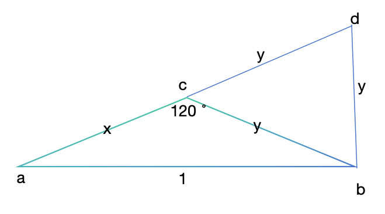
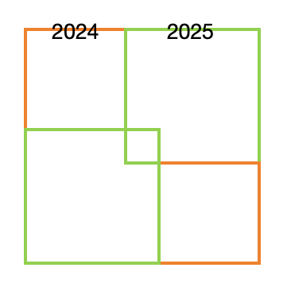

# 每日一题

## 20250812

化简$\sqrt{4+2\sqrt{3}}$，$\sqrt{8+4\sqrt{3}}$，$\sqrt{16+4\sqrt{7}}$

基于原理为通过$a^2 + b^2 + 2ab = (a+b)^2$和$\sqrt{x^2} = x$对数据进行化简

对于1式：
$$
a^2 + b^2 = 4 \\
ab = \sqrt{3} \rightarrow a^2b^2 = 3
$$
可以得到结果为$\sqrt{3} + 1$

对于2式：
$$
a^2 + b^2 = 8 \\
ab = 2\sqrt{3} \rightarrow a^2b^2 = 12
$$
可以得到结果为$\sqrt{6} + \sqrt{2}$

对于3式：
$$
a^2 + b^2 = 16 \\
ab = 2\sqrt{7} \rightarrow a^2b^2 = 28
$$
可以得到结果为$\sqrt{14} + \sqrt{2}$

## 20250813

比较$1.001^{1000}$和$2$的大小
$$
\begin{aligned}
1.001^{1000} &=  (1 + \frac{1}{1000})^{1000} \\
&= (1 + \frac{1}{1000}) \times (1 + \frac{1}{1000}) \times \dots \times (1 + \frac{1}{1000}) \\
&> (1 + \frac{1}{1000}) \times (1 + \frac{1}{1001}) \times \dots \times (1 + \frac{1}{1999}) \\
&= \frac{1001}{1000} \times \frac{1002}{1001} \times \dots \times \frac{2000}{1999}) \\
&= 2
\end{aligned}
$$

## 20250814

若$5a+3b=10$，求$ab$的最大值
$$
\begin{align}
&设 \quad 5a = 5 + t，3b = 5 - t \\
&则 \quad 5a \times 3b = 15ab = (5+t) \times (5-t) = 25 - t^2 \\
&\therefore ab = \frac{25}{15} - \frac{t^2}{15} \\
&\because t^2 >= 0 \\
&\therefore ab <= \frac{25}{15} = \frac{5}{3}
\end{align}
$$
也可以用几何法：
$$
\begin{flalign}
&原式 = 2\times\frac{5}{2}a + 2\times\frac{3}{2}b \\
&即 \quad 长宽分别为\frac{5}{2}a和\frac{3}{2}b的长方形的周长为10 \\
&\because 周长固定的长方形，只有当它是正方形时，面积才最大 \\
&\therefore \frac{5}{2}a \times \frac{3}{2}b <= \frac{10}{4} * \frac{10}{4} \\
&\therefore ab <= \frac{5}{3}
\end{flalign}
$$

## 20250815

已知$x^2+y^2+xy=1$，求$x+y$​的最大值

利用$(x-y)^2=x^2+y^2-2xy>=0$即$x^2+y^2>=2xy$
$$
\begin{align}
&\because x^2 + y^2 >= 2xy \\
&\therefore x^2 + y^2 + xy = 1 >= 3xy \\
&\therefore xy <= \frac{1}{3} \\
&\therefore (x+y)^2 = x^2 + y^2 + 2xy = 1 + xy <= \frac{4}{3} \\
&\therefore -\frac{2\sqrt{3}}{3} <= x + y <= \frac{2\sqrt{3}}{3} \\
&\therefore (x+y)_{max} = \frac{2\sqrt{3}}{3}
\end{align}
$$
利用万能K法
$$
\begin{flalign}
设 &\quad x+y = k \\
则 &\quad y = k - x \\
从而 &\quad x^2 + y^2 + xy = x^2 + (k-x)^2 + x(k-x) = x^2 - kx + k^2 = 1 \\
即 &\quad x^2 -kx + k^2-1 = 0 \\
要想该式有解，则&\quad\Delta = (-k)^2 - 4\times(k^2-1) = -3k^2 + 4 >= 0 \\
\therefore &\quad -\frac{2\sqrt{3}}{3} <= x + y <= \frac{2\sqrt{3}}{3} \\
\therefore &\quad (x+y)_{max} = \frac{2\sqrt{3}}{3}
\end{flalign}
$$
利用几何法
$$
\begin{flalign}
\because &\quad x^2  y^2 + xy = 1 \\ 
\therefore &\quad \frac{x^2 + y^2 - 1}{2xy} = -\frac{1}{2} \\
其满足 &\quad \cos\theta = \frac{a^2 + b^2 - c^2}{2ab} \\
\end{flalign}
$$
所以其表示的是如下的三角形abc。

延长边ac作一个长度为y的辅助线到顶点d，并将其和顶点b连接。因为夹角acb是120度，所以夹角bcd是60度，又因为cd和cb长度都是y，所以三角形bcd是等边三角形。

当前仅当ad是abd的外接圆的直径时可以取到最大，此时夹角abd为直角。从而$(x+y)_{max}=\frac{1}{\cos30^{\circ}}=\frac{2\sqrt{3}}{3}$

## 20250816

已知$x=2024^2 + 2025^2$，求$\sqrt{2x-1}$​

平方即正方形的面积，由此可得：

由图可知，$\sqrt{2x-1}=(2024+2025)^2 =4049^2$

## 20250817

已知$m + n = 15$，求$\sqrt{m^2+9} + \sqrt{n^2+25}$的最小值
$$
\begin{align}
\because \quad& m+n = 15 \\
\therefore \quad& (\sqrt{m^2+9} + \sqrt{n^2+25})_{min} \\
& = (\sqrt{m^2+9} + \sqrt{(15-m)^2+25})_{min} \\
& = (\sqrt{(0-m)^2+(3-0)^2} + \sqrt{(15-m)^2+(5-0)^2})_{min} \\
& = (|AP| + |PB|)_{min} && \text{设点A(0,3), P(m, 0), B(15, 5),因为P在x轴，所以这里AB一定不会经过P点，无法直接用AB的距离} \\
& = (|A‘P| + |PB|)_{min} && \text{设点A’(0,-3)为点A关于x轴的对称点} \\
& = |A'B| && \text{三角形两边之和一定大于第三边，为了取最小，必须要A'、P、B三点共线} \\
& = \sqrt{(0-15)^2 + (-3-5)^2} \\
& = \sqrt{289} = 17
\end{align}
$$
